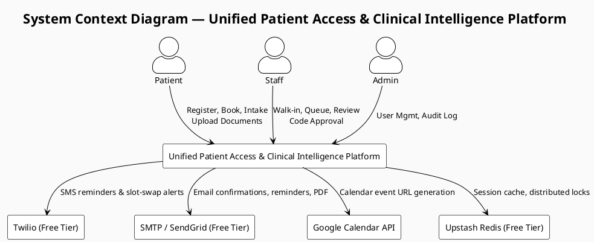
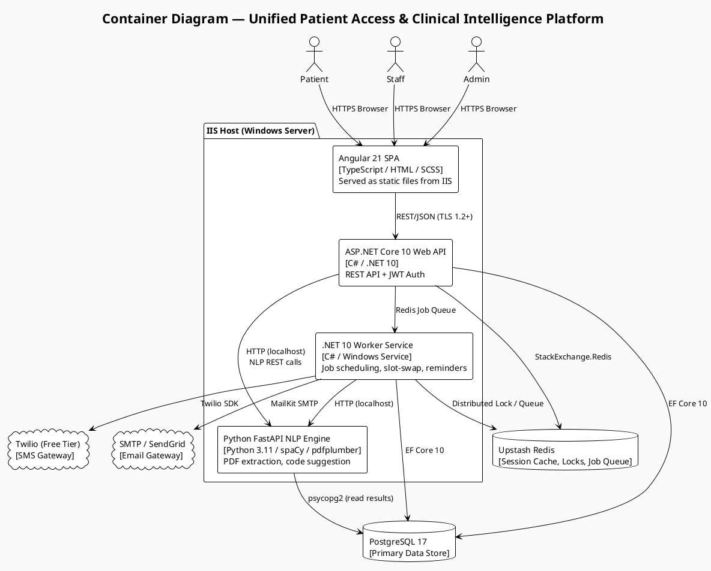
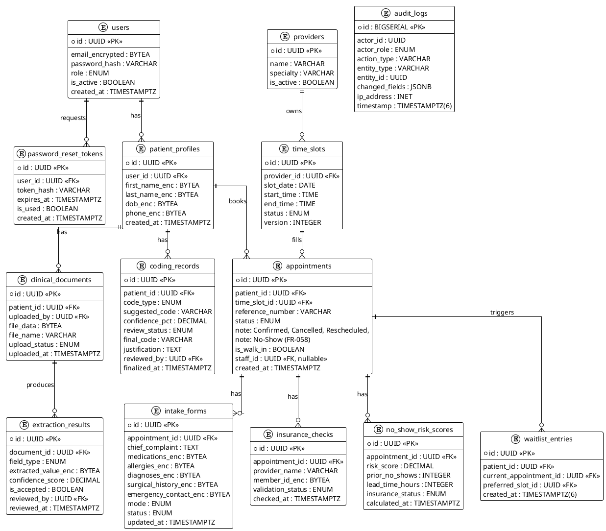
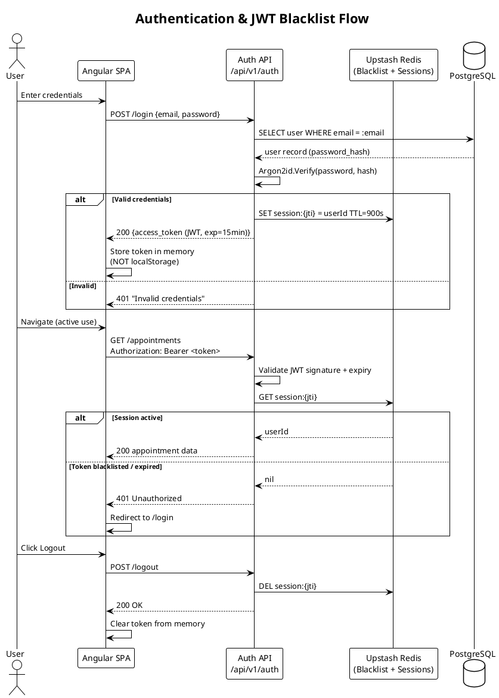
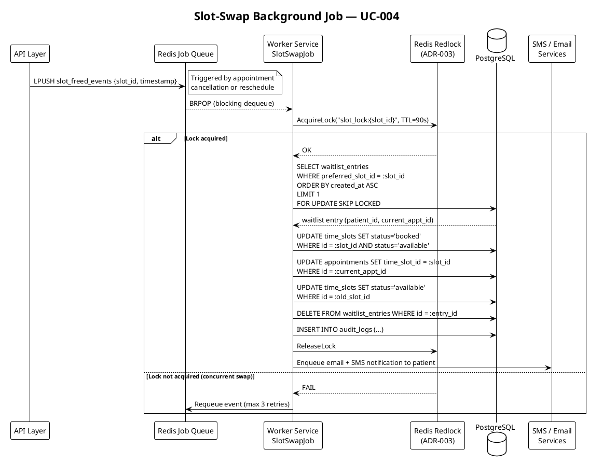
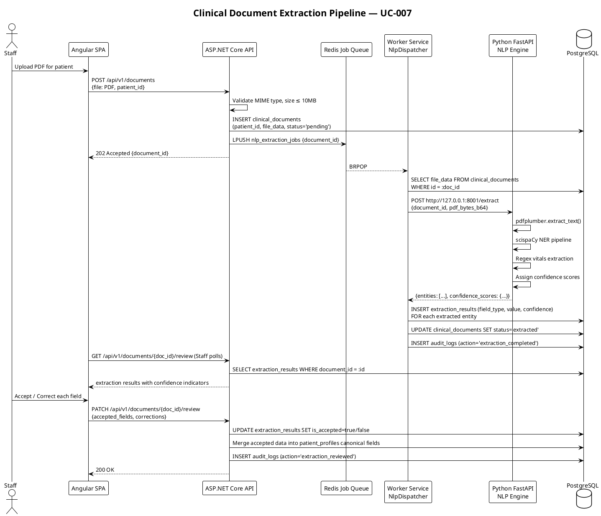
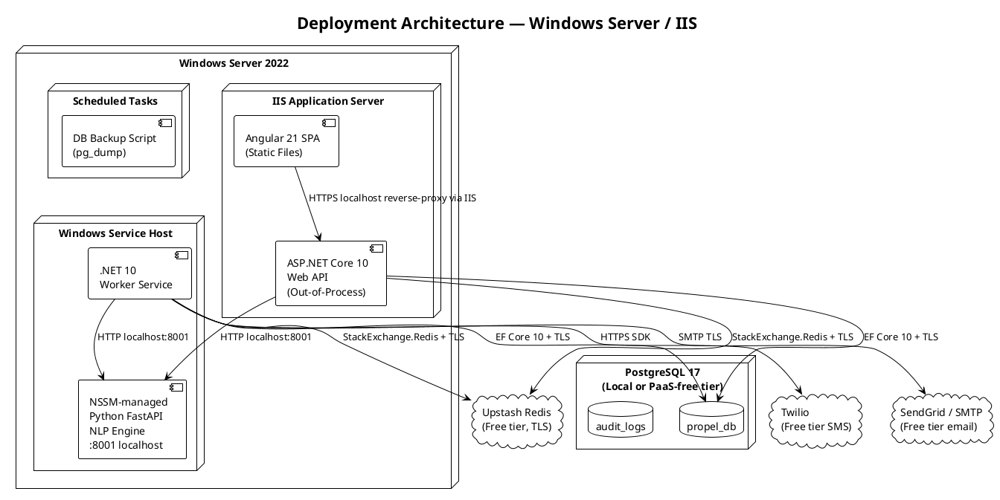
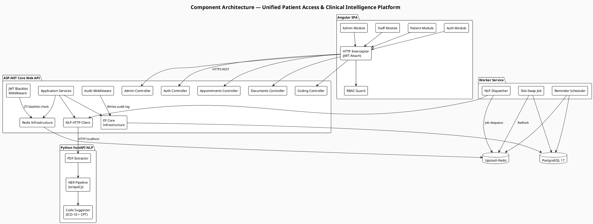

# Architecture Design Specification
# Unified Patient Access & Clinical Intelligence Platform

<!-- Schema: .propel/templates/design-specification-template.md -->
<!-- Artifact: design | Workflow: /design-architecture | Version: 1.0.0 -->

---

## Document Control

| Attribute     | Value                                                |
| ------------- | ---------------------------------------------------- |
| Status        | Draft                                                |
| Version       | 1.0.0                                                |
| Created       | 2026-05-28                                           |
| Updated       | 2026-05-28                                           |
| Author        | GitHub Copilot — generated from spec.md v1.0.0       |
| Source Spec   | `.propel/context/docs/spec.md`                       |

---

## 1. Introduction

This document is the authoritative architecture design specification for the **Unified Patient Access & Clinical Intelligence Platform** (Phase 1). It translates the Functional Requirements Specification (`spec.md`) into:

- A fully resolved technology stack with selection rationale
- Comprehensive Non-Functional Requirements (NFR-###)
- Technical Requirements (TR-###) for infrastructure and tooling
- Data Requirements (DR-###) for schema, retention, and privacy
- AI/Intelligence Requirements (AIR-###) for NLP and coding engines
- Architecture Decision Records (ADR-###) capturing key design choices
- UML structural and behavioural diagrams (PlantUML)

All decisions honour the constraints established in spec §7 (AC-1 through AC-9) and the HIPAA compliance mandate of NFR-001.

---

## 2. System Architecture Overview

### 2.1 Architectural Style

The platform adopts a **Modular Monolith** with a dedicated **AI Worker Service**, deployed as a single IIS application and a Windows Service on the same host. This balances the free-tier infrastructure constraint (AC-1 / AC-7) with the need for background processing (slot-swap, reminders, NLP extraction).

```
Browser / Mobile Browser
        │  HTTPS (TLS 1.2+)
        ▼
[ Angular 21 SPA ] ─── static assets on IIS
        │  REST/JSON   (TLS 1.2+)
        ▼
[ ASP.NET Core 10 Web API ] ──── IIS Kestrel + Windows Auth middleware
        │
   ┌────┴──────────────────────┐
   │                           │
   ▼                           ▼
[ PostgreSQL 17 ]        [ Upstash Redis ]
 (primary store)         (sessions, slot-swap locks, job queues)
        │
        ▼
[ .NET 10 Worker Service ]  ─── Windows Service
   (slot-swap, reminders, NLP job dispatch)
        │  HTTP (localhost)
        ▼
[ Python FastAPI NLP Engine ]  ─── localhost only
   (PDF extraction, ICD-10/CPT suggestion)
```

### 2.2 High-Level Context Diagram



### 2.3 Container Diagram (C4 Level 2)



---

## 3. Technology Stack

| Layer                   | Technology                         | Version | Justification                                                        |
| ----------------------- | ---------------------------------- | ------- | -------------------------------------------------------------------- |
| **Frontend SPA**        | Angular                            | 21      | TypeScript-first; component architecture; enterprise-grade RBAC routing; latest stable release as of May 2026 |
| **Backend API**         | ASP.NET Core Web API               | .NET 10 | Windows/IIS native (AC-7); mature HIPAA tooling; EF Core ORM        |
| **Background Jobs**     | .NET Worker Service (Windows Svc)  | .NET 10 | Native Windows Service host (AC-7); integrates with same codebase    |
| **AI / NLP Engine**     | Python FastAPI + spaCy + pdfplumber| 3.11    | Open-source NLP (AC-4); best-in-class PDF extraction; locally hosted |
| **Primary Database**    | PostgreSQL                         | 17      | Latest stable as of May 2026 (released Sep 2024); 5-year support until Nov 2029; HIPAA-capable encryption |
| **ORM**                 | Entity Framework Core              | 10      | Code-first migrations; typed queries; audit interceptors             |
| **Cache & Locks**       | Upstash Redis (free tier)          | 7.x     | Specified in AC-6; slot-swap atomic locks; session store             |
| **Redis Client**        | StackExchange.Redis                | 2.7+    | .NET standard Redis client                                           |
| **Authentication**      | ASP.NET Core Identity + JWT        | .NET 10 | RBAC; token-based; stateless API; server-side session invalidation via Redis |
| **Password Hashing**    | ASP.NET Core Identity (Argon2id)   | .NET 10 | FR-007; HIPAA-grade hashing                                          |
| **PDF Generation**      | QuestPDF                           | 2024+   | Open-source; appointment confirmation PDF (FR-014)                   |
| **PDF Extraction**      | pdfplumber + PyMuPDF               | latest  | Clinical document text extraction (FR-073)                           |
| **NLP / NER**           | spaCy + scispaCy models            | 3.7     | Medical NER for diagnoses, medications, vitals (FR-073)              |
| **Email**               | MailKit + SMTP / SendGrid free     | 4.x     | Multi-channel reminders (FR-031, FR-032, FR-014)                     |
| **SMS**                 | Twilio REST SDK (free tier)        | 7.x     | SMS reminders & slot-swap alerts (AC-2; FR-032, FR-023)              |
| **Calendar**            | RFC 5545 iCalendar (.ics)          | —       | Outlook add-to-calendar (FR-034)                                     |
| **Calendar URL**        | Google Calendar URL builder        | —       | Google calendar link (FR-033); no OAuth required                     |
| **API Documentation**   | Swashbuckle / OpenAPI 3.0          | .NET 10 | Auto-generated API docs                                              |
| **Validation**          | FluentValidation                   | 11+     | Request model validation; replaces DataAnnotations                   |
| **Logging**             | Serilog → PostgreSQL sink          | 3.x     | Structured audit log; immutable append (FR-111–FR-117)               |
| **Job Queue**           | Redis + .NET Channel               | —       | Slot-swap, extraction, reminder scheduling                           |
| **ICD-10 / CPT Data**   | CMS public datasets (CSV)          | 2025    | Freely licensed code libraries (AC-5)                                |
| **Testing (Unit)**      | xUnit + Moq + FluentAssertions     | .NET 10 | Backend unit tests                                                   |
| **Testing (E2E)**       | Playwright + TypeScript            | 1.44+   | End-to-end browser tests                                             |
| **CI**                  | GitHub Actions (free tier)         | —       | Free-tier CI; lint, test, build                                      |

---

## 4. Non-Functional Requirements

> This section expands the NFR summary in spec §8 into fully specified, testable requirements.

### 4.1 Security & Compliance

| ID      | Requirement                                                                                                                           | Priority | Source          |
| ------- | ------------------------------------------------------------------------------------------------------------------------------------- | -------- | --------------- |
| NFR-001 | All API communication shall use TLS 1.2 or higher; TLS 1.0/1.1 shall be disabled at the IIS level.                                  | Must     | AC-9, HIPAA     |
| NFR-002 | All patient PHI stored in PostgreSQL shall be encrypted at rest using PostgreSQL Transparent Data Encryption (TDE) or column-level encryption via pgcrypto. | Must | AC-9, HIPAA |
| NFR-003 | All passwords shall be hashed with Argon2id (memory ≥64 MB, iterations ≥3, parallelism ≥1) via ASP.NET Core Identity.               | Must     | FR-007, HIPAA   |
| NFR-004 | JWT access tokens shall have a maximum lifetime of 15 minutes; refresh tokens shall not be issued; re-authentication is required after expiry. | Must | FR-005, HIPAA |
| NFR-005 | Each API endpoint shall validate the caller's role claim server-side before processing; no client-side role enforcement shall be trusted. | Must   | FR-004, FR-008  |
| NFR-006 | The system shall enforce RBAC with three roles (Patient, Staff, Admin); privilege escalation via API manipulation shall be blocked.   | Must     | FR-004          |
| NFR-007 | Admin accounts shall be provisioned exclusively via a database seed script or CLI tool; no API endpoint shall accept Admin role assignment from client requests. | Must | FR-105, BR-7 |
| NFR-008 | The NLP engine (Python FastAPI) shall be bound to `127.0.0.1` only and not exposed to any external network interface.                | Must     | OWASP A01, HIPAA |
| NFR-009 | All file uploads shall be validated for MIME type (PDF only), maximum size (10 MB per file), and scanned for malicious content (ClamAV or equivalent open-source scanner). | Must | FR-071, OWASP A03 |
| NFR-010 | The system shall implement rate limiting on authentication endpoints: maximum 5 failed attempts per IP per 10-minute window, then 429 Too Many Requests. | Must | OWASP A07 |
| NFR-011 | All SQL queries shall use parameterised statements via EF Core; raw string interpolation in queries is prohibited.                    | Must     | OWASP A03       |
| NFR-012 | API responses shall not include stack traces, internal exception messages, or database schema details in error payloads.              | Must     | OWASP A05       |
| NFR-013 | CORS shall be configured to allow only the single known frontend origin; wildcard (`*`) origins shall be prohibited.                  | Must     | OWASP A05       |
| NFR-014 | HTTP security headers shall be set on all responses: `Strict-Transport-Security`, `X-Content-Type-Options`, `X-Frame-Options: DENY`, `Content-Security-Policy`. | Must | OWASP A05 |

### 4.2 Performance

| ID      | Requirement                                                                                                                       | Priority | Source   |
| ------- | --------------------------------------------------------------------------------------------------------------------------------- | -------- | -------- |
| NFR-021 | Appointment slot search API response time shall be ≤ 1 second at p95 under a load of 50 concurrent users.                       | Must     | NFR-005  |
| NFR-022 | Patient login API response time shall be ≤ 500 ms at p95.                                                                       | Must     | —        |
| NFR-023 | The slot-swap background job shall complete (detect, reserve, swap, notify) within 60 seconds of the triggering event.           | Must     | FR-024, NFR-005 |
| NFR-024 | The 360-Degree Patient View API shall return consolidated patient data within 2 seconds at p95.                                  | Should   | FR-079   |
| NFR-025 | Clinical document NLP extraction shall complete within 30 seconds per document for documents up to 10 MB.                       | Should   | FR-073   |
| NFR-026 | The same-day queue API shall support real-time updates via server-sent events (SSE) with a maximum staleness of 5 seconds.       | Must     | FR-053   |
| NFR-027 | PostgreSQL connection pooling shall be configured with a minimum pool size of 5 and maximum of 50 connections.                   | Must     | —        |
| NFR-028 | Redis cache TTL for session tokens shall match the JWT lifetime (15 minutes); slot-swap lock TTL shall be set to 90 seconds.     | Must     | FR-005, FR-025 |
| NFR-029 | JWT access token payloads shall contain only the minimum required claims: `sub` (user ID), `jti` (token ID), `role` (single role string), and `exp`. No additional user attributes, email addresses, or permission lists shall be embedded in the token. | Must | FR-008, OWASP A01 |

### 4.3 Reliability & Availability

| ID      | Requirement                                                                                                                       | Priority | Source   |
| ------- | --------------------------------------------------------------------------------------------------------------------------------- | -------- | -------- |
| NFR-031 | The platform shall target 99.9% uptime (≤ 8.7 hours downtime per year) within free-tier hosting constraints.                    | Must     | AC-8     |
| NFR-032 | The NLP extraction pipeline shall degrade gracefully: if the Python engine is unavailable, the API shall queue documents and retry up to 3 times with exponential back-off before returning a failure status. | Must | AC-4 |
| NFR-033 | The slot-swap job shall use Redis distributed locking (Redlock pattern) to prevent double-booking under concurrent events.       | Must     | FR-025   |
| NFR-034 | Background Worker Service shall include a health-check endpoint polled by IIS Application Initialisation every 30 seconds.      | Should   | —        |
| NFR-035 | Database migrations shall be applied via EF Core migration runner at application startup, gated by a distributed lock so only one instance runs migrations. | Must | — |
| NFR-036 | All outbound notifications (email, SMS) shall be sent via a retry-enabled job queue with at least 3 retry attempts; failures shall be logged and surfaced on an admin alert view. | Should | FR-023, FR-031, FR-032 |

### 4.4 Scalability

| ID      | Requirement                                                                                                                       | Priority | Source   |
| ------- | --------------------------------------------------------------------------------------------------------------------------------- | -------- | -------- |
| NFR-041 | The application shall be designed for single-instance deployment on Windows/IIS Phase 1, but the architecture shall not introduce barriers to horizontal scaling (stateless API, Redis-backed sessions). | Must | AC-7 |
| NFR-042 | Database schema shall use indexed foreign keys and composite indexes on high-frequency query columns (patient_id, appointment_date, provider_id). | Must | — |

### 4.5 Maintainability

| ID      | Requirement                                                                                                                       | Priority | Source   |
| ------- | --------------------------------------------------------------------------------------------------------------------------------- | -------- | -------- |
| NFR-051 | Backend code shall follow Clean Architecture layering: Domain, Application, Infrastructure, API; no Infrastructure references in Domain. | Must | — |
| NFR-052 | All API controllers shall be thin (≤ 30 lines); business logic shall reside in Application-layer service classes.                | Must     | —        |
| NFR-053 | All public interfaces in the Application layer shall have unit-test coverage ≥ 80%.                                              | Should   | —        |
| NFR-054 | Database schema changes shall be managed exclusively through EF Core 10 Code-First migrations; no manual DDL shall be applied.      | Must     | —        |

### 4.6 Usability & Accessibility

| ID      | Requirement                                                                                                                       | Priority | Source   |
| ------- | --------------------------------------------------------------------------------------------------------------------------------- | -------- | -------- |
| NFR-061 | The Angular SPA shall meet WCAG 2.1 Level AA accessibility standards.                                                            | Must     | —        |
| NFR-062 | The patient-facing intake form (AI and manual modes) shall be usable on mobile viewports (≥ 375 px width).                       | Must     | —        |
| NFR-063 | Colour contrast ratio for all text elements shall meet WCAG 2.1 AA minimum of 4.5:1.                                             | Must     | —        |

### 4.7 Audit & Compliance

| ID      | Requirement                                                                                                                       | Priority | Source        |
| ------- | --------------------------------------------------------------------------------------------------------------------------------- | -------- | ------------- |
| NFR-071 | Audit log entries shall be written to a dedicated `audit_logs` PostgreSQL table with no UPDATE or DELETE privileges granted to the application database role. | Must | FR-116, BR-6 |
| NFR-072 | Each audit log entry shall capture: `id`, `actor_id`, `actor_role`, `action_type`, `entity_type`, `entity_id`, `changed_fields` (JSONB), `ip_address`, `timestamp` (UTC, microsecond precision). | Must | FR-111 |
| NFR-073 | Audit log entries shall be exportable as CSV via a paginated Admin API; the export shall respect date-range and actor filters.    | Must     | FR-117        |
| NFR-074 | Audit log writes shall use a dedicated PostgreSQL role with INSERT-only permissions on the `audit_logs` table; all other application operations shall use a separate role. | Must | HIPAA, NFR-071 |

---

## 5. Technical Requirements

| ID     | Requirement                                                                                                                               | Priority | Notes                     |
| ------ | ----------------------------------------------------------------------------------------------------------------------------------------- | -------- | ------------------------- |
| TR-001 | The .NET 10 solution shall use a multi-project structure: `Api`, `Application`, `Domain`, `Infrastructure`, `Worker`, `NlpEngine` (Python). | Must     | NFR-051                   |
| TR-002 | The IIS application pool shall run under a dedicated service account with minimum required permissions; no `NETWORK SERVICE` or admin account. | Must | HIPAA, OWASP              |
| TR-003 | Application secrets (connection strings, API keys) shall be stored in Windows DPAPI-protected environment variables or `appsettings.{env}.json` excluded from source control; never committed as plaintext. | Must | OWASP A02 |
| TR-004 | The Python NLP engine shall be hosted as a Windows Service using NSSM (Non-Sucking Service Manager) and communicate with the .NET API via localhost HTTP only. | Must | AC-7                      |
| TR-005 | EF Core migrations shall be idempotent and reversible; each migration shall include a `Down()` method.                                   | Must     | NFR-054                   |
| TR-006 | The CI pipeline (GitHub Actions) shall execute on every pull request: lint (ESLint + dotnet format), unit tests, build, and SAST scan (Semgrep free). | Must | —                         |
| TR-007 | PostgreSQL shall be configured with `ssl = on` and `ssl_cert_file` / `ssl_key_file` for connections from the application; unencrypted connections shall be rejected. | Must | NFR-001, HIPAA |
| TR-008 | Upstash Redis shall be accessed exclusively over TLS (rediss:// scheme); plaintext Redis connections shall be prohibited.               | Must     | NFR-001, HIPAA            |
| TR-009 | The Angular SPA shall be built using `ng build --configuration production` with AOT compilation, tree-shaking, and no source maps in production (Angular 21 default). | Must | OWASP A05 |
| TR-010 | API versioning shall use URL path versioning (`/api/v1/...`) to allow future version introduction without breaking existing clients.      | Should   | —                         |
| TR-011 | The Worker Service shall implement `IHostedService` and graceful shutdown handling (max 30-second drain on `StopAsync`).                  | Must     | NFR-034                   |
| TR-012 | All third-party NuGet and pip packages shall be pinned to specific versions in `*.csproj` and `requirements.txt`; unpinned floating versions are prohibited. | Must | Supply chain security     |
| TR-013 | ICS calendar file generation shall conform to RFC 5545 and be tested against Outlook and Google Calendar import.                         | Must     | FR-034                    |
| TR-014 | The Twilio SDK shall be called exclusively from the Worker Service; the API layer shall enqueue SMS notifications, not send them directly. | Must | TR-001, NFR-036           |

---

## 6. Data Requirements

### 6.1 Data Classification

| Classification   | Examples                                        | Controls                                             |
| ---------------- | ----------------------------------------------- | ---------------------------------------------------- |
| PHI (HIPAA)      | Name, DOB, phone, diagnoses, medications, vitals | Encrypted at rest (pgcrypto); TLS in transit; audit logged |
| PII              | Email address, IP address                       | Encrypted at rest; redacted in non-admin log exports |
| Clinical Content | PDF documents, extracted NLP text               | Stored in DB or filesystem with restricted ACL       |
| System Data      | Audit logs, job queue entries, sessions          | Integrity protected; audit logs INSERT-only          |
| Reference Data   | ICD-10 codes, CPT codes, insurance dummy records | Read-only; no PHI; publicly licensed (AC-5)          |

### 6.2 Data Requirements

| ID     | Requirement                                                                                                                                 | Priority | Source       |
| ------ | ------------------------------------------------------------------------------------------------------------------------------------------- | -------- | ------------ |
| DR-001 | All PHI fields (name, DOB, phone, clinical data) shall be stored using column-level encryption via pgcrypto (`pgp_sym_encrypt`) with AES-256. | Must   | AC-9, HIPAA  |
| DR-002 | Patient email addresses shall be stored in a separate encrypted column; email shall not appear in unencrypted query result sets.            | Must     | HIPAA        |
| DR-003 | Uploaded clinical PDF files shall be stored in the PostgreSQL database as `BYTEA` (for files ≤ 10 MB) rather than filesystem, to maintain consistent access control and backup. | Must | FR-071 |
| DR-004 | Extracted NLP text snippets and confidence scores shall be persisted in a dedicated `extraction_results` table linked to the source document. | Must    | FR-074       |
| DR-005 | The `audit_logs` table shall use a `BIGSERIAL` primary key and a `GENERATED ALWAYS AS IDENTITY` constraint; no application-generated IDs. | Must    | NFR-071      |
| DR-006 | The `appointments` table shall enforce a unique partial index on `(patient_id, provider_id, appointment_date)` WHERE status = 'confirmed' to enforce BR-1. | Must | BR-1, FR-017 |
| DR-007 | The `waitlist_entries` table shall record `created_at` with microsecond precision as the FIFO ordering key for slot-swap (BR-2).           | Must     | BR-2, FR-025 |
| DR-008 | Appointment slots shall be modelled as `time_slots` (provider_id, date, start_time, end_time, status) independent of bookings, with an optimistic lock version column. | Must | FR-011, FR-025 |
| DR-009 | Session data shall be stored exclusively in Upstash Redis; no session data shall be persisted in PostgreSQL.                               | Must     | FR-005, AC-6 |
| DR-010 | Data retention policy: audit logs shall be retained for a minimum of 7 years; patient records shall be retained for a minimum of 10 years; inactive session data in Redis expires per TTL. | Must | HIPAA |
| DR-011 | The insurance dummy records dataset shall be stored in a read-only `insurance_reference` table seeded at deployment; no patient API shall write to this table. | Must | FR-062, AC-3 |
| DR-012 | The ICD-10 and CPT reference tables shall be loaded from CMS public CSV exports during database seeding; version date shall be recorded in a `reference_metadata` table. | Must | AC-5, FR-091 |
| DR-013 | AI-suggested codes and human review decisions shall be stored in a `coding_records` table with immutable row status (accepted / overridden / rejected) and a `reviewed_by` FK. | Must | FR-094, FR-095 |
| DR-014 | The `no_show_risk_scores` table shall record the rule inputs (prior_no_shows, lead_time_hours, insurance_status) and composite score for each appointment for retrospective analysis. | Should | FR-035 |
| DR-015 | A dedicated `password_reset_tokens` table shall store patient password-reset requests with columns: `id` (UUID PK), `user_id` (FK), `token_hash` (VARCHAR — bcrypt hash of the one-time token), `expires_at` (TIMESTAMPTZ, maximum 1-hour TTL), `is_used` (BOOLEAN default false). The token shall be invalidated (is_used = true) on first use; expired tokens shall be purged by a nightly scheduled task. | Must | FR-006 |

### 6.3 Entity Relationship Overview



---

## 7. AI / Intelligence Requirements

| ID      | Requirement                                                                                                                                  | Priority | Source       |
| ------- | -------------------------------------------------------------------------------------------------------------------------------------------- | -------- | ------------ |
| AIR-001 | The NLP extraction engine shall use scispaCy (en_core_sci_md or en_core_sci_lg) for named entity recognition on clinical text.               | Must     | AC-4, FR-073 |
| AIR-002 | The extraction engine shall identify and extract: PROBLEM (diagnoses), TREATMENT (medications, procedures), TEST (vitals markers), DATE entities. | Must | FR-073       |
| AIR-003 | Each extracted entity shall be assigned a confidence score in the range [0.0, 1.0]; scores < 0.75 shall be classified as low-confidence and flagged for mandatory staff review. | Must | FR-074 |
| AIR-004 | Vitals extraction shall use regex-pattern matching in addition to NER to capture structured formats (e.g., "BP: 120/80 mmHg", "HR: 72 bpm"). | Must     | FR-073       |
| AIR-005 | Medication extraction shall de-duplicate against existing patient medications using normalised drug name matching (case-insensitive, strip dosage). | Must | FR-077     |
| AIR-006 | Conflict detection shall flag cases where two documents contain non-identical values for the same drug name within the same 7-day window.    | Must     | FR-078, BR-9 |
| AIR-007 | ICD-10 code suggestion shall use a keyword-vector similarity model (TF-IDF cosine similarity or sentence-transformers) trained on CMS ICD-10 code descriptions against confirmed diagnoses. | Must | FR-091, AC-5 |
| AIR-008 | CPT code suggestion shall use keyword matching against CMS CPT code description dataset for confirmed procedures in the patient record.       | Must     | FR-092, AC-5 |
| AIR-009 | Each suggested ICD-10 / CPT code shall include: code value, description, source document ID, extracted text snippet (max 200 chars), confidence percentage. | Must | FR-093 |
| AIR-010 | The AI-Human Agreement Rate shall be computed per coding session as: `(accepted codes) / (accepted + overridden + rejected codes) × 100%`.   | Must     | FR-096       |
| AIR-011 | The system shall target ≥ 98% AI-Human Agreement Rate as per the success criterion in spec §8 / AC-4.                                        | Should   | AC-4, FR-096 |
| AIR-012 | The conversational intake AI shall use a rule-based dialogue manager (not a generative LLM) to guide patients through fixed intake questions, ensuring deterministic, auditable behaviour. | Must | FR-041, HIPAA |
| AIR-013 | All AI model artefacts (spaCy models, TF-IDF vectoriser pickle files) shall be versioned and stored locally; no external model API calls shall be made. | Must | AC-1, HIPAA |
| AIR-014 | The NLP engine shall expose a `/health` endpoint and a `/extract` POST endpoint; responses shall include processing duration for performance monitoring. | Must | NFR-025, TR-004 |

---

## 8. Architecture Decision Records

### ADR-001 — Modular Monolith over Microservices

| Attribute   | Value                                                                      |
| ----------- | -------------------------------------------------------------------------- |
| Status      | Accepted                                                                   |
| Date        | 2026-05-28                                                                 |
| Deciders    | Architecture Team                                                          |

**Context**: The platform must run on free-tier / Windows IIS infrastructure (AC-7). Microservices require orchestration (Kubernetes), separate deployment pipelines, and network overhead that is incompatible with AC-1.

**Decision**: Adopt a Modular Monolith with Clean Architecture layers. The Python NLP engine is the sole separate process, communicating via localhost HTTP, justified by the language boundary (Python NLP libraries vs. .NET).

**Consequences**: Simpler deployment; single CI/CD pipeline; reduced operational overhead. Vertical scaling remains feasible. Horizontal scaling requires Redis session externalization (already addressed by AC-6).

---

### ADR-002 — JWT with Redis Blacklist for Session Invalidation

| Attribute   | Value                                                                      |
| ----------- | -------------------------------------------------------------------------- |
| Status      | Accepted                                                                   |
| Date        | 2026-05-28                                                                 |

**Context**: FR-005 requires 15-minute inactivity timeout with server-side invalidation. Pure stateless JWT cannot be server-invalidated. Redis is already in the stack (AC-6).

**Decision**: Issue short-lived JWT (15-minute expiry, no refresh token). Track active token IDs in Redis with 15-minute TTL. On logout or timeout, add token JTI to a Redis blacklist. Middleware validates token JTI against the blacklist on every request.

**Consequences**: Adds one Redis read per request (sub-millisecond). Satisfies HIPAA server-side invalidation requirement. No refresh token attack surface.

---

### ADR-003 — Redis Redlock for Atomic Slot-Swap

| Attribute   | Value                                                                      |
| ----------- | -------------------------------------------------------------------------- |
| Status      | Accepted                                                                   |
| Date        | 2026-05-28                                                                 |

**Context**: FR-025 requires atomic reservation to prevent double-booking under concurrent slot-swap events. PostgreSQL row-level locking alone is insufficient when multiple Worker Service instances could theoretically run.

**Decision**: Use Redlock distributed locking pattern (via RedLock.net library) with a 90-second TTL on the slot lock key `slot_lock:{slot_id}`. Only one process acquires the lock and performs the swap. Slot status is set to `reserved` in PostgreSQL within the locked window.

**Consequences**: Prevents double-booking. Lock TTL must exceed worst-case swap processing time. Requires Redis availability for slot-swap to function (graceful degradation: slot remains available if lock cannot be acquired).

---

### ADR-004 — PostgreSQL-Backed Immutable Audit Log

| Attribute   | Value                                                                      |
| ----------- | -------------------------------------------------------------------------- |
| Status      | Accepted                                                                   |
| Date        | 2026-05-28                                                                 |

**Context**: FR-116 / BR-6 require write-once audit log entries. A dedicated logging service (Splunk, DataDog) would violate AC-1 (paid cloud).

**Decision**: Use a dedicated `audit_logs` PostgreSQL table with a separate INSERT-only database role. A PostgreSQL `RULE` prevents UPDATE and DELETE on this table at the database level. Serilog PostgreSQL sink writes entries. Application code uses a separate `DbContext` bound to the audit-only role.

**Consequences**: Audit data is co-located with primary data (simplifies backup). Insert-only DB role enforced at the database engine level, not just application layer. Admin CSV export reads directly from this table via a paginated query.

---

### ADR-005 — Conversational Intake as Rule-Based Dialogue, Not Generative LLM

| Attribute   | Value                                                                      |
| ----------- | -------------------------------------------------------------------------- |
| Status      | Accepted                                                                   |
| Date        | 2026-05-28                                                                 |

**Context**: FR-041 requires a conversational AI intake interface. Generative LLMs (GPT, Claude) require paid API calls, have non-deterministic output, and introduce HIPAA data-handling risks if PHI is sent to external services.

**Decision**: Implement a state-machine dialogue manager in the Angular frontend. Each intake question is a fixed step in the state machine. "AI" presentation is cosmetic (animated assistant, natural-language question phrasing). No external LLM API calls. Data is collected client-side and submitted as a structured form.

**Consequences**: Deterministic, auditable, HIPAA-safe. Zero cost. "AI mode" delivers guided UX without generative AI risks. Clearly documented in UI so patients understand the nature of the interface.

---

### ADR-006 — PDF Storage in PostgreSQL BYTEA

| Attribute   | Value                                                                      |
| ----------- | -------------------------------------------------------------------------- |
| Status      | Accepted                                                                   |
| Date        | 2026-05-28                                                                 |

**Context**: Clinical PDF documents are PHI and must be encrypted at rest. Filesystem storage on IIS requires separate ACL management and backup coordination.

**Decision**: Store uploaded PDFs as `BYTEA` in the `clinical_documents` table (max 10 MB per file enforced at API). PostgreSQL TDE / pgcrypto encryption covers BYTEA columns uniformly. Backup of the database covers documents automatically.

**Consequences**: Simplifies access control and backup. PostgreSQL storage will grow with document uploads; monitor table size and implement archival strategy before Phase 2.

---

## 9. Component Design

### 9.1 Backend API — Module Structure

```
Propel.Api/                     ← ASP.NET Core Web API entry point
  Controllers/
    AuthController.cs           ← FR-001–FR-008
    AppointmentsController.cs   ← FR-011–FR-017, FR-061–FR-065
    IntakeController.cs         ← FR-041–FR-046
    StaffController.cs          ← FR-051–FR-057
    NoShowController.cs         ← FR-058 (query No-Show status; auto-mark driven by Worker)
    DocumentsController.cs      ← FR-071–FR-080
    CodingController.cs         ← FR-091–FR-096
    AdminController.cs          ← FR-101–FR-105, FR-111–FR-117, FR-118–FR-120
  Middleware/
    JwtBlacklistMiddleware.cs   ← ADR-002
    AuditMiddleware.cs          ← FR-111–FR-115

Propel.Application/             ← Business logic
  Auth/
  Appointments/
  Intake/
  Documents/
  Coding/
  Admin/
  Notifications/
  SlotSwap/

Propel.Domain/                  ← Entities, value objects, domain rules
  Entities/
  Enums/
  Exceptions/

Propel.Infrastructure/          ← EF Core, Redis, external services
  Persistence/
    PropelDbContext.cs
    AuditDbContext.cs           ← ADR-004 (INSERT-only role)
    Migrations/
  Cache/
    RedisSessionStore.cs
    SlotSwapLockService.cs      ← ADR-003
  Notifications/
    EmailService.cs
    SmsService.cs
  NlpClient/
    NlpEngineClient.cs          ← HTTP client to Python engine

Propel.Worker/                  ← .NET Worker Service (Windows Service)
  Jobs/
    SlotSwapJob.cs
    ReminderSchedulerJob.cs
    NlpExtractionDispatcher.cs
    NoShowAutoMarkJob.cs        ← FR-058 (marks appointments as No-Show after end time)
  Program.cs

Propel.NlpEngine/               ← Python FastAPI (separate process)
  main.py
  extraction/
    pdf_extractor.py
    ner_pipeline.py
    vitals_regex.py
    dedup_engine.py
  coding/
    icd10_suggester.py
    cpt_suggester.py
  models/
    (scispaCy model artefacts)
  requirements.txt
```

### 9.2 Frontend SPA — Module Structure

```
src/
  app/
    core/                       ← Auth service, RBAC guards, HTTP interceptors
    shared/                     ← Reusable components, pipes
    features/
      auth/                     ← Login, register, password reset
      patient/
        appointments/           ← Booking, cancellation, reschedule
        intake/                 ← AI mode + manual mode state machine (ADR-005)
        documents/              ← Upload, view summary
      staff/
        queue/                  ← Same-day queue, arrived marking
        walk-in/                ← Walk-in booking
        clinical-review/        ← Extraction review, 360° view
        coding/                 ← ICD-10 / CPT review
      admin/
        users/                  ← User management
        audit-log/              ← Log viewer + CSV export
        metrics/                ← No-show rate, conflicts count, adoption stats (FR-118–FR-120)
```

---

## 10. Security Architecture

### 10.1 Authentication & Authorisation Flow



### 10.2 Role-Based Access Control Matrix

| Resource                    | Patient          | Staff            | Admin            | System |
| --------------------------- | ---------------- | ---------------- | ---------------- | ------ |
| Register / Login            | Own account      | Own account      | Own account      | —      |
| Book appointment            | Own bookings     | On behalf of any | —                | —      |
| View 360° patient view      | Own summary only | Full view        | Full view        | —      |
| Upload clinical document    | Own profile      | Any patient      | —                | —      |
| Review extraction results   | —                | Any patient      | —                | —      |
| Medical coding panel        | —                | Any patient      | —                | —      |
| Same-day queue              | —                | Full access      | Read-only        | —      |
| Mark arrived                | —                | Yes              | —                | —      |
| User management             | —                | —                | Full access      | —      |
| Audit log                   | —                | —                | Read + Export    | —      |
| Slot-swap execution         | —                | —                | —                | Yes    |
| Send reminders              | —                | —                | —                | Yes    |

---

## 11. Integration Architecture

### 11.1 Slot-Swap Sequence



### 11.2 Clinical Document Extraction Sequence



---

## 12. Deployment Architecture

### 12.1 Windows Server / IIS Deployment



### 12.2 Environment Configuration

| Environment | API Base URL       | PostgreSQL       | Redis         | NLP Engine     |
| ----------- | ------------------ | ---------------- | ------------- | -------------- |
| Development | `http://localhost:5000` | localhost:5432 | localhost:6379 | localhost:8001 |
| Staging     | `https://staging.propeliq.internal` | Staging PG | Upstash staging | localhost:8001 |
| Production  | `https://propeliq.internal` | Prod PG (TLS) | Upstash prod (TLS) | localhost:8001 |

All environment-specific values are stored in Windows environment variables; `appsettings.Production.json` is excluded from source control via `.gitignore`.

---

## 13. No-Show Risk Engine

### 13.1 Rule-Based Scoring Model

The no-show risk score is computed as a weighted sum of three inputs (FR-035):

> **Outcome recording (FR-058)**: A `NoShowAutoMarkJob` Windows Service job runs every 5 minutes and sets `appointments.status = No-Show` for any appointment whose `time_slots.end_time` has passed and whose status is not `Arrived`. An audit log entry is written for each auto-marked appointment (FR-112). This outcome data feeds `no_show_risk_scores.prior_no_shows` for future bookings and the Admin no-show rate metric (FR-118).

$$\text{RiskScore} = w_1 \cdot P_{\text{no-show}} + w_2 \cdot \text{LeadTimeFactor} + w_3 \cdot \text{InsuranceFactor}$$

| Input | Symbol | Weight | Rule |
| ----- | ------ | ------ | ---- |
| Historical no-show rate | $P_{\text{no-show}}$ | 0.50 | `prior_no_shows / total_prior_appointments` (0.0–1.0) |
| Lead time factor | $\text{LeadTimeFactor}$ | 0.30 | 1.0 if lead time > 7 days; 0.5 if 2–7 days; 0.0 if < 2 days |
| Insurance validation | $\text{InsuranceFactor}$ | 0.20 | 0.0 = Verified; 0.5 = Not Found; 1.0 = Mismatch |

- **Low risk**: score < 0.30 (green)
- **Medium risk**: 0.30 ≤ score < 0.60 (amber)
- **High risk**: score ≥ 0.60 (red)

---

## 14. UML Component Diagram



---

## 15. Traceability Matrix — Design to Spec

| Design Section      | FR Coverage                                    | NFR Coverage              |
| ------------------- | ---------------------------------------------- | ------------------------- |
| ADR-002 (JWT+Redis) | FR-004, FR-005, FR-007, FR-008                 | NFR-001–NFR-006, NFR-029  |
| ADR-003 (Redlock)   | FR-025                                         | NFR-033                   |
| ADR-004 (Audit)     | FR-111–FR-117                                  | NFR-071–NFR-074           |
| ADR-005 (Intake AI) | FR-041–FR-046                                  | NFR-001 (no PHI to LLM)   |
| ADR-006 (PDF store) | FR-071, FR-072, FR-076                         | NFR-002 (encrypted at rest)|
| DR-001–DR-015       | FR-006, FR-017, FR-025, FR-062, FR-071–FR-079, FR-091–FR-096 | NFR-002, NFR-071 |
| AIR-001–AIR-014     | FR-041, FR-073–FR-079, FR-091–FR-096           | NFR-025                   |
| NFR-021–NFR-028     | FR-011, FR-024, FR-053, FR-079                 | NFR-005 (performance)     |
| NFR-071–NFR-074     | FR-111–FR-117                                  | NFR-006 (audit)           |
| TR-001–TR-014       | All                                            | NFR-051–NFR-054           |
| No-Show Engine §13  | FR-035, FR-036, FR-058, FR-064                 | —                         |
| AdminController §9 | FR-101–FR-105, FR-118–FR-120                  | —                         |

---

## 16. Open Issues & Risks

| ID   | Type    | Description                                                                                               | Mitigation                                                  |
| ---- | ------- | --------------------------------------------------------------------------------------------------------- | ----------------------------------------------------------- |
| OI-1 | Risk    | Upstash Redis free tier has connection limits that may impact concurrent slot-swap lock performance.      | Monitor connection count; upgrade to paid tier if needed.   |
| OI-2 | Risk    | scispaCy model (en_core_sci_lg, ~800 MB) may require more RAM than typical free-tier Windows VM.          | Use `en_core_sci_md` (lighter) as the default Phase 1 model.|
| OI-3 | Risk    | Twilio free trial SMS delivery is restricted to verified numbers only.                                    | Document limitation; use verified test numbers in dev/staging.|
| OI-4 | Decision | PostgreSQL TDE via pgcrypto vs. OS-level disk encryption for BYTEA columns — final choice pending DBA review. | Confirm encryption strategy before Sprint 1 database setup. |
| OI-5 | Decision | Python FastAPI NLP engine — WSGI (Uvicorn) vs. Gunicorn for production; Windows NSSM process management.  | Document startup script in `Propel.NlpEngine/start.bat`.   |

---

*End of Design Specification — Version 1.0.0 | Status: Draft | 2026-05-28*
