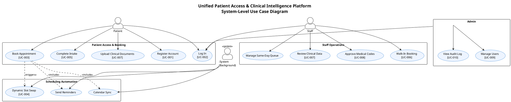
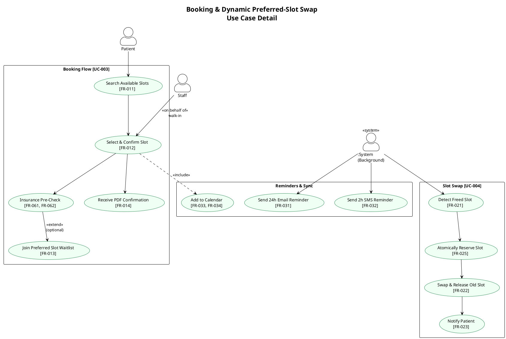
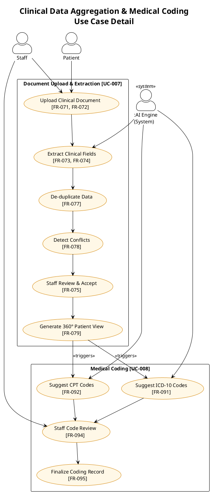

# Functional Requirements Specification
# Unified Patient Access & Clinical Intelligence Platform

<!-- Schema: .propel/templates/requirements-template.md -->
<!-- Artifact: spec | Workflow: /create-spec | Version: 1.0.0 -->

---

## Document Control

| Attribute  | Value                                          |
| ---------- | ---------------------------------------------- |
| Status     | Draft                                          |
| Version    | 1.0.0                                          |
| Created    | 2026-05-20                                     |
| Updated    | 2026-05-20                                     |
| Author     | GitHub Copilot — generated from BRD v1.0       |
| Source BRD | Business Requirements Document (attached PDF)  |

---

## 1. Introduction

This document defines the functional requirements and use cases for the **Unified Patient Access & Clinical Intelligence Platform** (Phase 1). It translates the Business Requirements Document (BRD) into testable, traceable FR-### requirements and UC-### use cases that serve as the authoritative input for downstream design, development, and test workflows.

The platform addresses two interconnected healthcare pain points:

1. **Scheduling inefficiency** — complex booking journeys, high no-show rates (up to 15%), and lack of smart reminders.
2. **Clinical data bottleneck** — clinical staff spend 20+ minutes manually extracting patient data from unstructured PDF reports.

---

## 2. Scope

### 2.1 In-Scope (Phase 1)

- Patient self-service registration and appointment booking (including waitlist)
- Dynamic preferred-slot swap (automatic upgrade when preferred slot opens)
- Rule-based no-show risk assessment surfaced to staff
- Multi-channel automated reminders (SMS / Email)
- Google and Outlook calendar sync via free APIs
- PDF appointment confirmation emailed to patient after booking
- Flexible patient intake (AI conversational or manual form, freely switchable)
- Staff-only walk-in booking and same-day queue management
- Staff marking of "Arrived" status (no patient self-check-in)
- Insurance pre-check (soft validation against internal dummy records)
- Clinical document upload and automated data extraction (vitals, history, medications)
- 360-Degree Patient View with de-duplication and conflict highlighting
- ICD-10 and CPT code suggestion from aggregated patient data
- Staff review and approval / override of AI-suggested codes
- Admin user and role management
- Immutable audit logging for all patient and staff actions

### 2.2 Out-of-Scope (Phase 1)

- Provider logins or provider-facing actions
- Payment gateway integration (reserved for future phases)
- Family member profile management
- Patient self-check-in via mobile app, web portal, or QR code
- Direct bi-directional EHR integration or full claims submission
- Paid cloud infrastructure (AWS, Azure, etc.)

---

## 3. Stakeholders & User Roles

| Role    | Description                                                                                     |
| ------- | ----------------------------------------------------------------------------------------------- |
| Patient | Registered individual who books appointments, completes intake, and uploads clinical documents. |
| Staff   | Front-desk or call-center operator who manages bookings, queues, and patient arrival status.    |
| Admin   | Platform administrator who manages user accounts, assigns roles, and reviews audit logs.        |
| System  | Background automation actor responsible for slot-swap, reminders, and AI-driven extractions.   |

---

## 4. Functional Requirements

### 4.1 Authentication & Session Management

| ID      | Requirement Description                                                                                                                     | Priority | Source        |
| ------- | ------------------------------------------------------------------------------------------------------------------------------------------- | -------- | ------------- |
| FR-001  | The system shall allow patients to self-register with email, password, first name, last name, date of birth, and phone number.              | Must     | BRD §6        |
| FR-002  | The system shall authenticate staff via username and password credentials managed by the Admin.                                             | Must     | BRD §6        |
| FR-003  | The system shall authenticate admin users via username and password.                                                                        | Must     | BRD §6        |
| FR-004  | The system shall enforce role-based access control (RBAC) with three discrete roles: Patient, Staff, and Admin.                             | Must     | BRD §4, §7    |
| FR-005  | The system shall enforce a 15-minute inactivity session timeout and log out the user automatically upon expiry.                             | Must     | BRD §7        |
| FR-006  | The system shall provide a secure password-reset flow for patients via a time-limited, single-use email link.                               | Must     | BRD §6        |
| FR-007  | The system shall hash and salt all stored passwords using an industry-standard algorithm (e.g., bcrypt / Argon2).                           | Must     | BRD §7 (HIPAA)|
| FR-008  | The system shall not expose user role information in client-side tokens or API responses beyond what the consuming role requires.            | Must     | BRD §7 (HIPAA)|

### 4.2 Appointment Booking — Patient

| ID      | Requirement Description                                                                                                                        | Priority | Source  |
| ------- | ---------------------------------------------------------------------------------------------------------------------------------------------- | -------- | ------- |
| FR-011  | The system shall allow a patient to search available appointment slots by specialty, provider name, and date range.                            | Must     | BRD §6  |
| FR-012  | The system shall allow a patient to book one available appointment slot per session, confirming the booking with a unique appointment reference number. | Must  | BRD §6  |
| FR-013  | The system shall allow a patient to optionally select a preferred unavailable slot at time of booking, placing them on a waitlist for that slot. | Must    | BRD §4  |
| FR-014  | The system shall send an appointment confirmation email containing a PDF summary (date, time, provider, location, reference number) upon successful booking. | Must | BRD §6 |
| FR-015  | The system shall allow a patient to cancel an upcoming appointment online with at least 2 hours' notice.                                       | Must     | BRD §6  |
| FR-016  | The system shall allow a patient to reschedule an upcoming appointment online, releasing the original slot upon confirmation.                  | Should   | BRD §6  |
| FR-017  | The system shall prevent a patient from holding more than one active booking for the same provider on the same calendar day.                   | Must     | BRD §6  |

### 4.3 Dynamic Preferred-Slot Swap

| ID      | Requirement Description                                                                                                                                                      | Priority | Source |
| ------- | ---------------------------------------------------------------------------------------------------------------------------------------------------------------------------- | -------- | ------ |
| FR-021  | When a preferred waitlisted slot becomes available (due to cancellation or reschedule), the system shall automatically swap the patient's current booking to the preferred slot. | Must   | BRD §4 |
| FR-022  | Upon a successful slot swap, the system shall automatically release the patient's previously held slot back to the available pool.                                           | Must     | BRD §4 |
| FR-023  | Upon a successful slot swap, the system shall notify the patient via email and SMS with updated appointment details.                                                         | Must     | BRD §4 |
| FR-024  | The system shall process slot-swap logic within 60 seconds of a triggering cancellation or reschedule event.                                                                 | Must     | BRD §4 |
| FR-025  | The system shall handle concurrent slot-swap requests using an atomic reservation mechanism to prevent double-booking.                                                       | Must     | BRD §7 |

### 4.4 Appointment Reminders & Calendar Sync

| ID      | Requirement Description                                                                                                                       | Priority | Source |
| ------- | --------------------------------------------------------------------------------------------------------------------------------------------- | -------- | ------ |
| FR-031  | The system shall send an automated email reminder to the patient 24 hours before the appointment.                                             | Must     | BRD §6 |
| FR-032  | The system shall send an automated SMS reminder to the patient 2 hours before the appointment.                                                | Must     | BRD §6 |
| FR-033  | The system shall provide a one-click "Add to Google Calendar" link within the confirmation and reminder emails using a free calendar API.      | Must     | BRD §6 |
| FR-034  | The system shall provide a one-click "Add to Outlook Calendar" (.ics download) link within the confirmation and reminder emails.              | Must     | BRD §6 |
| FR-035  | The system shall compute a no-show risk score for each booked appointment using a rule-based engine (inputs: prior no-shows, lead-time, insurance validation status). | Should | BRD §4 |
| FR-036  | The system shall surface the no-show risk score and contributing factors to Staff on the appointment management view.                         | Should   | BRD §4 |

### 4.5 Patient Intake

| ID      | Requirement Description                                                                                                                                        | Priority | Source |
| ------- | -------------------------------------------------------------------------------------------------------------------------------------------------------------- | -------- | ------ |
| FR-041  | The system shall provide a conversational AI intake interface where the patient answers guided questions to populate their intake form.                         | Must     | BRD §4 |
| FR-042  | The system shall provide a traditional manual form intake interface covering the same data fields as the AI intake.                                             | Must     | BRD §4 |
| FR-043  | The system shall allow a patient to freely switch between AI and manual intake modes at any point without losing previously entered data.                       | Must     | BRD §4 |
| FR-044  | The system shall allow a patient to edit previously submitted intake responses independently, without requiring staff assistance.                               | Must     | BRD §4 |
| FR-045  | The intake form shall collect: chief complaint, current medications, known allergies, prior diagnoses, surgical history, and emergency contact.                | Must     | BRD §6 |
| FR-046  | The system shall save intake progress automatically so a patient can resume an incomplete intake from any device.                                              | Should   | BRD §6 |

### 4.6 Staff Operations

| ID      | Requirement Description                                                                                                                                        | Priority | Source |
| ------- | -------------------------------------------------------------------------------------------------------------------------------------------------------------- | -------- | ------ |
| FR-051  | The system shall allow staff to create a walk-in booking on behalf of a patient without requiring a prior patient account.                                     | Must     | BRD §4 |
| FR-052  | During walk-in booking, the system shall optionally prompt staff to create a patient account (email + password) for the walk-in patient for post-visit access. | Should   | BRD §4 |
| FR-053  | The system shall present staff with a real-time same-day appointment queue, sortable by appointment time and arrival status.                                   | Must     | BRD §4 |
| FR-054  | The system shall allow staff to mark a patient as "Arrived" on the same-day queue.                                                                            | Must     | BRD §4 |
| FR-055  | The system shall prevent patients from self-checking-in via the web portal, mobile interface, or QR code; only staff may update arrival status.                | Must     | BRD §4 |
| FR-056  | The system shall allow staff to view, cancel, or reschedule any booked appointment.                                                                            | Must     | BRD §6 |
| FR-057  | The system shall allow staff to view the no-show risk dashboard for all appointments in the current and next business day.                                     | Should   | BRD §4 |
| FR-058  | The system shall automatically set an appointment's status to "No-Show" when the appointment's scheduled end time passes and the patient has not been marked as "Arrived"; this status shall be recorded in the appointment record and audit log. | Must | BRD §8 |

### 4.7 Insurance Pre-Check

| ID      | Requirement Description                                                                                                                               | Priority | Source |
| ------- | ----------------------------------------------------------------------------------------------------------------------------------------------------- | -------- | ------ |
| FR-061  | The system shall allow a patient (or staff on behalf of a patient) to enter an insurance provider name and member ID during or after booking.         | Must     | BRD §6 |
| FR-062  | The system shall perform a soft validation of the entered insurance name and member ID against an internal predefined set of dummy insurance records.   | Must     | BRD §6 |
| FR-063  | The system shall display a validation result of "Verified", "Not Found", or "Mismatch" to the patient and staff.                                      | Must     | BRD §6 |
| FR-064  | The system shall include the insurance validation status as a contributing factor to the no-show risk score calculation (FR-035).                      | Should   | BRD §4 |
| FR-065  | The insurance validation shall be a non-blocking soft check; booking shall proceed regardless of the validation outcome.                              | Must     | BRD §6 |

### 4.8 Clinical Document Upload & Data Extraction

| ID      | Requirement Description                                                                                                                                                 | Priority | Source |
| ------- | ----------------------------------------------------------------------------------------------------------------------------------------------------------------------- | -------- | ------ |
| FR-071  | The system shall allow a patient to upload one or more historical clinical documents in PDF format to their profile.                                                    | Must     | BRD §6 |
| FR-072  | The system shall allow staff to upload post-visit clinical notes (PDF or plain text) to a patient profile.                                                             | Must     | BRD §6 |
| FR-073  | The system shall extract the following data fields from uploaded documents: vitals (BP, HR, weight, height), current medications, diagnoses, allergies, and visit dates. | Must    | BRD §3 |
| FR-074  | The system shall present an extraction confidence indicator for each extracted data field, distinguishing between high-confidence and low-confidence extractions.        | Must     | BRD §4 |
| FR-075  | The system shall allow staff to review, accept, or correct each AI-extracted data field before it is committed to the patient record.                                  | Must     | BRD §4 |
| FR-076  | The system shall support upload of multiple documents per patient and aggregate data across all uploaded documents.                                                     | Must     | BRD §3 |
| FR-077  | The system shall perform de-duplication of extracted data across multiple documents, retaining the most recent non-conflicting value as the canonical entry.            | Must     | BRD §4 |
| FR-078  | The system shall explicitly detect and surface critical data conflicts (e.g., two documents listing different active medications for the same drug category) as conflict alerts. | Must | BRD §4 |
| FR-079  | The system shall generate a 360-Degree Patient View dashboard aggregating all confirmed patient data: demographics, vitals history, medication list, diagnoses, allergies, and visit timeline. | Must | BRD §3 |
| FR-080  | The system shall restrict access to the 360-Degree Patient View to Staff and Admin roles only; Patients may view their own summary only.                               | Must     | BRD §7 |

### 4.9 Medical Coding (ICD-10 & CPT)

| ID      | Requirement Description                                                                                                                               | Priority | Source |
| ------- | ----------------------------------------------------------------------------------------------------------------------------------------------------- | -------- | ------ |
| FR-091  | The system shall suggest ICD-10 diagnosis codes based on confirmed diagnoses and symptoms in the aggregated patient record.                           | Must     | BRD §6 |
| FR-092  | The system shall suggest CPT procedure codes based on confirmed procedures in the aggregated patient record.                                          | Must     | BRD §6 |
| FR-093  | Each AI-suggested code shall be accompanied by the source document, extracted text snippet, and a confidence percentage for transparency.             | Must     | BRD §4 |
| FR-094  | Staff shall be able to accept, reject, or override any AI-suggested ICD-10 or CPT code before the coding record is finalized.                        | Must     | BRD §4 |
| FR-095  | The system shall record the final human-reviewed coding record (accepted, overridden, and rejected codes) in the patient's immutable audit log.       | Must     | BRD §7 |
| FR-096  | The system shall track AI-Human Agreement Rate per coding session to support the >98% accuracy success criterion.                                     | Should   | BRD §8 |

### 4.10 Admin — User & Role Management

| ID      | Requirement Description                                                                                                                        | Priority | Source |
| ------- | ---------------------------------------------------------------------------------------------------------------------------------------------- | -------- | ------ |
| FR-101  | The system shall allow the Admin to create Staff accounts with a username, email, and temporary password.                                      | Must     | BRD §6 |
| FR-102  | The system shall allow the Admin to assign or modify the role (Staff, Patient) of any non-admin account.                                       | Must     | BRD §6 |
| FR-103  | The system shall allow the Admin to deactivate any user account, preventing further login without deleting data.                               | Must     | BRD §6 |
| FR-104  | The system shall allow the Admin to reactivate a previously deactivated account.                                                               | Should   | BRD §6 |
| FR-105  | Admin accounts shall only be created via a secure, out-of-band mechanism (e.g., database seed or CLI); no self-registration is permitted for Admin. | Must   | BRD §7 |

### 4.11 Audit Logging

| ID      | Requirement Description                                                                                                                                                             | Priority | Source     |
| ------- | ----------------------------------------------------------------------------------------------------------------------------------------------------------------------------------- | -------- | ---------- |
| FR-111  | The system shall create an immutable audit log entry for every patient record creation, modification, and deletion, capturing actor, timestamp, action type, and changed fields.    | Must     | BRD §7     |
| FR-112  | The system shall create an audit log entry for every appointment booking, cancellation, reschedule, walk-in creation, and slot-swap event.                                          | Must     | BRD §7     |
| FR-113  | The system shall create an audit log entry for every clinical document upload, extraction run, data acceptance, and override.                                                       | Must     | BRD §7     |
| FR-114  | The system shall create an audit log entry for every medical coding session, recording accepted, overridden, and rejected codes.                                                    | Must     | BRD §7     |
| FR-115  | The system shall create an audit log entry for every login, logout, failed login attempt, and session timeout event.                                                                | Must     | BRD §7     |
| FR-116  | Audit log entries shall be write-once; no user role (including Admin) shall be permitted to modify or delete audit log records.                                                     | Must     | BRD §7     |
| FR-117  | The Admin shall be able to query and export audit log entries filtered by date range, actor, and action type.                                                                       | Must     | BRD §7     |
### 4.12 Admin — Operational Success Metrics

| ID      | Requirement Description                                                                                                                                                             | Priority | Source     |
| ------- | ----------------------------------------------------------------------------------------------------------------------------------------------------------------------------------- | -------- | ---------- |
| FR-118  | The system shall provide an Admin dashboard displaying the platform's no-show rate (percentage of appointments with status "No-Show" over a selectable date range), to enable demonstrable reduction measurement per BRD §8. | Must | BRD §8 |
| FR-119  | The system shall provide an Admin dashboard widget displaying the total count of critical data conflicts detected (FR-078) over a selectable date range, enabling the "Critical Conflicts Identified" quantifiable success metric defined in BRD §8. | Must | BRD §8 |
| FR-120  | The system shall provide an Admin dashboard widget displaying total patient accounts created and total appointments successfully booked over a selectable date range, to support the "Platform Adoption" success criterion in BRD §8. | Should | BRD §8 |
---

## 5. Use Cases

### UC-001 — Register as Patient

| Attribute        | Detail                                                                                                          |
| ---------------- | --------------------------------------------------------------------------------------------------------------- |
| **Actors**       | Patient                                                                                                         |
| **Precondition** | Patient has no existing account.                                                                                |
| **Trigger**      | Patient navigates to the registration page.                                                                     |
| **References**   | FR-001, FR-007                                                                                                  |

**Main Flow**

1. Patient enters email, password, first name, last name, date of birth, and phone number.
2. System validates all fields and checks email uniqueness.
3. System hashes the password and creates the account with role = Patient.
4. System sends a verification email to the patient.
5. Patient clicks the verification link; account is activated.
6. System redirects patient to the login page.

**Alternate Flows**

- **A1 — Email already registered**: System displays an error message and prompts the patient to log in or use password reset.
- **A2 — Weak password**: System displays password policy requirements and blocks submission.

**Postcondition**: Patient account is created and activated; patient can log in.

---

### UC-002 — Log In

| Attribute        | Detail                                                                                                     |
| ---------------- | ---------------------------------------------------------------------------------------------------------- |
| **Actors**       | Patient, Staff, Admin                                                                                      |
| **Precondition** | User has an active account.                                                                                |
| **Trigger**      | User navigates to the login page and submits credentials.                                                  |
| **References**   | FR-002, FR-003, FR-004, FR-005, FR-007, FR-008                                                             |

**Main Flow**

1. User enters username / email and password.
2. System validates credentials against the hashed password store.
3. System creates an authenticated session scoped to the user's role.
4. System redirects user to their role-specific dashboard.
5. Session expires automatically after 15 minutes of inactivity (FR-005).

**Alternate Flows**

- **A1 — Invalid credentials**: System displays a generic "Invalid credentials" error (no hint on which field is wrong).
- **A2 — Deactivated account**: System displays "Account is disabled. Contact your administrator."
- **A3 — Session timeout**: System invalidates the session and redirects to login with a timeout notification.

**Postcondition**: User is authenticated and on their dashboard.

---

### UC-003 — Book Appointment (Patient)

| Attribute        | Detail                                                                                                                    |
| ---------------- | ------------------------------------------------------------------------------------------------------------------------- |
| **Actors**       | Patient                                                                                                                   |
| **Precondition** | Patient is logged in; at least one available slot exists.                                                                 |
| **Trigger**      | Patient selects "Book Appointment" from their dashboard.                                                                  |
| **References**   | FR-011, FR-012, FR-013, FR-014, FR-017, FR-061, FR-062, FR-063                                                            |

**Main Flow**

1. Patient searches for available slots by specialty, provider, and date range.
2. System returns a list of available slots.
3. Patient selects an available slot.
4. System checks for duplicate booking on the same day with the same provider (FR-017).
5. Patient optionally selects a preferred unavailable slot from a waitlist picker.
6. Patient enters / confirms insurance name and member ID (FR-061).
7. System performs soft insurance validation and displays result (FR-062, FR-063).
8. Patient reviews booking summary and confirms.
9. System persists the booking, assigns an appointment reference number.
10. System emails a PDF confirmation to the patient (FR-014).
11. System enqueues the patient's preferred slot on the waitlist (if selected).

**Alternate Flows**

- **A1 — No available slots**: System informs the patient and offers waitlist-only booking.
- **A2 — Duplicate booking detected**: System blocks the booking and explains the constraint.
- **A3 — Insurance not found**: System shows "Not Found" status; booking proceeds (FR-065).

**Postcondition**: Appointment is confirmed; patient is on the waitlist for preferred slot if applicable.

---

### UC-004 — Dynamic Preferred-Slot Swap (System)

| Attribute        | Detail                                                                                                                          |
| ---------------- | ------------------------------------------------------------------------------------------------------------------------------- |
| **Actors**       | System (background)                                                                                                             |
| **Precondition** | A patient has a confirmed booking and is on the waitlist for a preferred slot.                                                  |
| **Trigger**      | A cancellation or reschedule event frees the preferred slot.                                                                    |
| **References**   | FR-021, FR-022, FR-023, FR-024, FR-025                                                                                          |

**Main Flow**

1. A slot-freeing event occurs (cancellation / reschedule).
2. System identifies all waitlist entries targeting the freed slot, ordered by waitlist entry timestamp.
3. System atomically reserves the slot for the first-in-queue patient (FR-025).
4. System updates the patient's booking to the new slot.
5. System releases the patient's previously held slot back to the available pool (FR-022).
6. System sends an SMS and email notification to the patient with updated appointment details (FR-023).
7. System removes the fulfilled waitlist entry.
8. System logs the swap event in the audit log (FR-112).

**Alternate Flows**

- **A1 — No waitlisted patients for that slot**: Slot becomes generally available with no swap.
- **A2 — Patient cancels waitlist entry before swap occurs**: System removes the entry and moves to the next in queue.

**Postcondition**: Patient is booked in preferred slot; original slot is available; patient is notified.

---

### UC-005 — Complete Patient Intake

| Attribute        | Detail                                                                                                         |
| ---------------- | -------------------------------------------------------------------------------------------------------------- |
| **Actors**       | Patient                                                                                                        |
| **Precondition** | Patient has a confirmed appointment; intake has not been completed.                                            |
| **Trigger**      | Patient opens the intake form from their appointment dashboard or intake reminder email.                       |
| **References**   | FR-041, FR-042, FR-043, FR-044, FR-045, FR-046                                                                 |

**Main Flow**

1. Patient selects intake mode: AI Conversational or Manual Form.
2. System renders the selected intake interface.
3. *(AI mode)* System guides patient through questions covering chief complaint, medications, allergies, diagnoses, surgical history, and emergency contact.
4. *(Manual mode)* Patient fills in structured form fields directly.
5. System auto-saves progress after each step (FR-046).
6. Patient reviews the summary and submits.
7. System marks intake as complete and links data to the appointment record.

**Alternate Flows**

- **A1 — Mode switch**: Patient switches mode mid-intake; system transfers all data entered so far to the other interface without loss (FR-043).
- **A2 — Incomplete session**: Patient closes the browser; system retains progress for resumption on next login (FR-046).
- **A3 — Post-submission edit**: Patient edits a previously submitted intake field; system saves the revision and logs the change in the audit log (FR-044).

**Postcondition**: Intake data is saved; available for clinical staff review before the appointment.

---

### UC-006 — Manage Walk-In Booking (Staff)

| Attribute        | Detail                                                                                                              |
| ---------------- | ------------------------------------------------------------------------------------------------------------------- |
| **Actors**       | Staff                                                                                                               |
| **Precondition** | Staff is logged in; at least one available same-day slot exists.                                                    |
| **Trigger**      | A patient arrives without a prior appointment.                                                                      |
| **References**   | FR-051, FR-052, FR-053, FR-054, FR-055, FR-056                                                                      |

**Main Flow**

1. Staff searches for available same-day slots.
2. Staff selects a slot and enters the patient's details (name, DOB, phone number).
3. System checks for an existing patient account by email or phone.
4. *(Existing patient found)* System links the booking to the existing account.
5. *(New patient)* Staff optionally creates a new patient account (FR-052).
6. System confirms the walk-in booking and adds the patient to the same-day queue (FR-053).
7. When the patient is ready, staff marks the patient as "Arrived" (FR-054).

**Alternate Flows**

- **A1 — No same-day slots**: Staff is warned; system allows creating a non-slot-linked walk-in queue entry.
- **A2 — Account creation skipped**: Walk-in is booked without a linked patient account; record is flagged for post-visit account creation.

**Postcondition**: Walk-in patient is booked and visible on the same-day queue; arrival can be tracked.

---

### UC-007 — Upload & Process Clinical Documents

| Attribute        | Detail                                                                                                         |
| ---------------- | -------------------------------------------------------------------------------------------------------------- |
| **Actors**       | Patient (upload), Staff (upload / review), System (extraction)                                                 |
| **Precondition** | Patient account exists; document is in PDF format.                                                             |
| **Trigger**      | Patient or Staff initiates document upload to a patient profile.                                               |
| **References**   | FR-071, FR-072, FR-073, FR-074, FR-075, FR-076, FR-077, FR-078, FR-079, FR-080                                 |

**Main Flow**

1. Patient or Staff navigates to the patient's document section and uploads a PDF.
2. System validates file format and size.
3. System queues the document for extraction processing.
4. System extracts: vitals, medications, diagnoses, allergies, visit dates.
5. System assigns a confidence indicator to each extracted field.
6. System de-duplicates extracted data against the existing patient record (FR-077).
7. System detects and flags critical data conflicts with the existing record (FR-078).
8. System presents the extraction review panel to Staff.
9. Staff reviews, accepts, or corrects each extracted field (FR-075).
10. Staff confirms; system commits accepted data to the 360-Degree Patient View (FR-079).
11. Audit log entry is created for the upload, extraction, and review actions.

**Alternate Flows**

- **A1 — Low-confidence extraction**: System flags the field in yellow; Staff manually enters the correct value.
- **A2 — Critical conflict detected**: System displays a conflict alert before commit; Staff must explicitly acknowledge the conflict.
- **A3 — Corrupt or unreadable PDF**: System returns an error; upload is discarded; Staff is prompted to retry.

**Postcondition**: Verified patient data is consolidated in the 360-Degree Patient View; audit trail is complete.

---

### UC-008 — Review & Approve Medical Codes

| Attribute        | Detail                                                                                                      |
| ---------------- | ----------------------------------------------------------------------------------------------------------- |
| **Actors**       | Staff                                                                                                       |
| **Precondition** | Patient has at least one confirmed clinical record; ICD-10 / CPT suggestion run has completed.              |
| **Trigger**      | Staff opens the coding review panel for a patient.                                                          |
| **References**   | FR-091, FR-092, FR-093, FR-094, FR-095, FR-096                                                              |

**Main Flow**

1. Staff navigates to the medical coding panel for the patient.
2. System displays AI-suggested ICD-10 and CPT codes with source snippets and confidence percentages (FR-093).
3. Staff reviews each suggestion.
4. Staff accepts or overrides each code.
5. Staff submits the final coding record.
6. System commits the finalized codes and logs the human review outcome in the audit log (FR-095).
7. System records the agreement / override decision for AI-Human Agreement Rate tracking (FR-096).

**Alternate Flows**

- **A1 — Code rejected entirely**: Staff rejects the suggestion; system marks it as rejected in the audit log with a mandatory justification note.
- **A2 — Manual code added**: Staff adds a code not suggested by AI; system logs it as a manual addition.

**Postcondition**: Finalized coding record is committed; AI-Human Agreement Rate data is captured.

---

### UC-009 — Manage Users (Admin)

| Attribute        | Detail                                                                                       |
| ---------------- | -------------------------------------------------------------------------------------------- |
| **Actors**       | Admin                                                                                        |
| **Precondition** | Admin is logged in.                                                                          |
| **Trigger**      | Admin opens the User Management console.                                                     |
| **References**   | FR-101, FR-102, FR-103, FR-104, FR-105                                                       |

**Main Flow**

1. Admin searches for a user by name or email.
2. Admin views user details: role, status, last login.
3. Admin creates a new Staff account with a temporary password (FR-101).
4. Admin assigns or modifies user roles as needed (FR-102).
5. Admin deactivates an account when required (FR-103).
6. System logs all admin actions in the audit log.

**Alternate Flows**

- **A1 — Reactivate account**: Admin selects a deactivated account and reactivates it (FR-104).
- **A2 — Attempt to create Admin account**: System rejects admin-role assignment via the UI; Admin accounts are seeded externally only (FR-105).

**Postcondition**: User accounts reflect the Admin's changes; all changes are audited.

---

### UC-010 — View Audit Log (Admin)

| Attribute        | Detail                                                                            |
| ---------------- | --------------------------------------------------------------------------------- |
| **Actors**       | Admin                                                                             |
| **Precondition** | Admin is logged in.                                                               |
| **Trigger**      | Admin opens the Audit Log viewer.                                                 |
| **References**   | FR-111, FR-112, FR-113, FR-114, FR-115, FR-116, FR-117                            |

**Main Flow**

1. Admin opens the Audit Log panel.
2. Admin applies optional filters: date range, actor (user), action type.
3. System returns matching log entries in reverse chronological order.
4. Admin reviews individual log entries.
5. Admin exports the filtered log as a CSV file (FR-117).

**Alternate Flows**

- **A1 — Attempt to modify log entry**: System rejects the action; audit entries are write-once (FR-116).

**Postcondition**: Admin has reviewed and optionally exported the audit log.

---

## 6. Business Rules

| ID   | Rule                                                                                                                          |
| ---- | ----------------------------------------------------------------------------------------------------------------------------- |
| BR-1 | A patient may not have more than one active confirmed booking with the same provider on the same calendar day.                |
| BR-2 | Preferred-slot swap is processed in FIFO order; the earliest waitlist entry timestamp wins.                                   |
| BR-3 | Insurance pre-check is non-blocking; a "Not Found" result does not prevent booking.                                           |
| BR-4 | Only Staff may perform walk-in bookings and mark patient arrival; patients cannot self-check-in.                              |
| BR-5 | All AI-extracted clinical data must pass Staff review before being committed to the patient record.                           |
| BR-6 | Audit log entries are immutable; no role (including Admin) may modify or delete them.                                         |
| BR-7 | Admin accounts may only be provisioned via a database seed or CLI mechanism; self-registration for Admin is prohibited.       |
| BR-8 | Session timeout is 15 minutes; all roles are subject to this limit without exception.                                         |
| BR-9 | Critical data conflicts in clinical documents must be explicitly acknowledged by Staff before data is committed.              |

---

## 7. Assumptions & Constraints

| ID   | Assumption / Constraint                                                                                                                         |
| ---- | ----------------------------------------------------------------------------------------------------------------------------------------------- |
| AC-1 | The platform is hosted on free, open-source-friendly infrastructure (Netlify, Vercel, GitHub Codespaces, or equivalent); paid cloud is excluded. |
| AC-2 | SMS delivery relies on a free-tier SMS API (e.g., Twilio free tier); delivery guarantees are best-effort.                                       |
| AC-3 | Insurance validation operates against an internal dummy dataset; no real insurer API integration is in scope.                                   |
| AC-4 | Clinical document extraction is performed using open-source NLP tooling; accuracy targets are ≥98% AI-Human Agreement Rate.                    |
| AC-5 | ICD-10 and CPT code libraries are sourced from publicly available, freely licensed datasets.                                                   |
| AC-6 | The data layer is PostgreSQL; Upstash Redis (free tier) is used for session caching and slot-swap coordination.                                 |
| AC-7 | Windows Services / IIS is the target native deployment runtime.                                                                                |
| AC-8 | Platform must target 99.9% uptime within the constraints of free-tier hosting.                                                                 |
| AC-9 | All data at rest and in transit must comply with HIPAA; TLS 1.2+ is mandatory for all API communication.                                       |

---

## 8. Non-Functional Requirements Summary

> NFRs are fully specified in the Design Specification (`design.md`). This section summarises NFRs that directly constrain functional behaviour.

| ID      | Category               | Summary                                                                                                       |
| ------- | ---------------------- | ------------------------------------------------------------------------------------------------------------- |
| NFR-001 | Security & Compliance  | 100% HIPAA-compliant data handling, transmission (TLS 1.2+), and storage (encrypted at rest).                 |
| NFR-002 | Access Control         | Strict RBAC; each API endpoint enforces role claims; no role escalation permitted client-side.                |
| NFR-003 | Session                | 15-minute inactivity timeout applies to all roles; server-side session invalidation mandatory.                |
| NFR-004 | Reliability            | 99.9% uptime target; graceful degradation on NLP processing failures.                                        |
| NFR-005 | Performance            | Appointment search response ≤ 1 s (p95); slot-swap processing ≤ 60 s.                                        |
| NFR-006 | Audit                  | Immutable write-once audit log; no soft deletes or updates permitted on audit records.                        |
| NFR-007 | Infrastructure         | Native deployment via Windows Services / IIS; PostgreSQL + Upstash Redis (free tier).                        |

---

## 9. Use Case Diagrams

> PlantUML source files are located in `.propel/context/docs/uml-models/`.

### 9.1 System-Level Use Case Overview

### 9.2 Booking & Preferred-Slot Swap Flow

### 9.3 Clinical Intelligence Flow

---

## 10. Traceability Matrix

| FR      | UC(s)          | BRD Section | NFR(s)          |
| ------- | -------------- | ----------- | --------------- |
| FR-001  | UC-001         | §6          | NFR-001         |
| FR-002  | UC-002         | §6          | NFR-002         |
| FR-003  | UC-002         | §6          | NFR-002         |
| FR-004  | UC-002         | §4, §7      | NFR-002         |
| FR-005  | UC-002         | §7          | NFR-003         |
| FR-006  | UC-001         | §6          | NFR-001         |
| FR-007  | UC-001, UC-002 | §7          | NFR-001         |
| FR-008  | UC-002         | §7          | NFR-001, NFR-002|
| FR-011  | UC-003         | §6          | NFR-005         |
| FR-012  | UC-003         | §6          | NFR-005         |
| FR-013  | UC-003, UC-004 | §4          | —               |
| FR-014  | UC-003         | §6          | —               |
| FR-015  | UC-003         | §6          | —               |
| FR-016  | UC-003         | §6          | —               |
| FR-017  | UC-003         | §6          | —               |
| FR-021  | UC-004         | §4          | NFR-005         |
| FR-022  | UC-004         | §4          | —               |
| FR-023  | UC-004         | §4          | —               |
| FR-024  | UC-004         | §4          | NFR-005         |
| FR-025  | UC-004         | §7          | NFR-004         |
| FR-031  | UC-003         | §6          | —               |
| FR-032  | UC-003         | §6          | —               |
| FR-033  | UC-003         | §6          | —               |
| FR-034  | UC-003         | §6          | —               |
| FR-035  | UC-006         | §4          | —               |
| FR-036  | UC-006         | §4          | —               |
| FR-041  | UC-005         | §4          | —               |
| FR-042  | UC-005         | §4          | —               |
| FR-043  | UC-005         | §4          | —               |
| FR-044  | UC-005         | §4          | NFR-006         |
| FR-045  | UC-005         | §6          | —               |
| FR-046  | UC-005         | §6          | —               |
| FR-051  | UC-006         | §4          | —               |
| FR-052  | UC-006         | §4          | —               |
| FR-053  | UC-006         | §4          | —               |
| FR-054  | UC-006         | §4          | —               |
| FR-055  | UC-006         | §4          | NFR-002         |
| FR-056  | UC-006         | §6          | —               |
| FR-057  | UC-006         | §4          | —               |
| FR-058  | UC-006         | §8          | NFR-006         |
| FR-061  | UC-003         | §6          | —               |
| FR-062  | UC-003         | §6          | —               |
| FR-063  | UC-003         | §6          | —               |
| FR-064  | UC-003         | §4          | —               |
| FR-065  | UC-003         | §6          | —               |
| FR-071  | UC-007         | §6          | NFR-001         |
| FR-072  | UC-007         | §6          | NFR-001         |
| FR-073  | UC-007         | §3          | —               |
| FR-074  | UC-007         | §4          | —               |
| FR-075  | UC-007         | §4          | NFR-006         |
| FR-076  | UC-007         | §3          | —               |
| FR-077  | UC-007         | §4          | —               |
| FR-078  | UC-007         | §4          | NFR-006         |
| FR-079  | UC-007         | §3          | —               |
| FR-080  | UC-007         | §7          | NFR-002         |
| FR-091  | UC-008         | §6          | —               |
| FR-092  | UC-008         | §6          | —               |
| FR-093  | UC-008         | §4          | —               |
| FR-094  | UC-008         | §4          | —               |
| FR-095  | UC-008         | §7          | NFR-006         |
| FR-096  | UC-008         | §8          | —               |
| FR-101  | UC-009         | §6          | NFR-002         |
| FR-102  | UC-009         | §6          | NFR-002         |
| FR-103  | UC-009         | §6          | NFR-002         |
| FR-104  | UC-009         | §6          | —               |
| FR-105  | UC-009         | §7          | NFR-002         |
| FR-111  | UC-010         | §7          | NFR-006         |
| FR-112  | UC-010         | §7          | NFR-006         |
| FR-113  | UC-010         | §7          | NFR-006         |
| FR-114  | UC-010         | §7          | NFR-006         |
| FR-115  | UC-010         | §7          | NFR-006         |
| FR-116  | UC-010         | §7          | NFR-006         |
| FR-117  | UC-010         | §7          | NFR-006         |
| FR-118  | UC-009         | §8          | —               |
| FR-119  | UC-007, UC-009 | §8          | —               |
| FR-120  | UC-009         | §8          | —               |

---

*End of Specification — Version 1.0.0 | Status: Draft | 2026-05-20*
